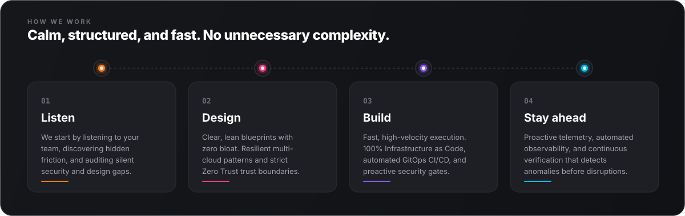
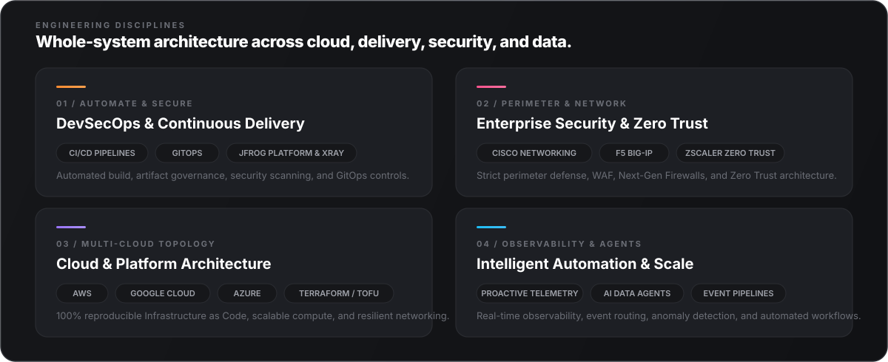

  

    

  
  
  
  
  

   

  `100% Infrastructure as Code` &nbsp;&bull;&nbsp; `Zero-Downtime Continuous Delivery` &nbsp;&bull;&nbsp; `Zero Trust Security Governance`

 

---

## How We Work

Calm, structured, and fast. No unnecessary complexity. We partner with engineering teams from early architectural blueprints to enterprise-scale production.

  

 

| Stage | Focus Area | Deliverables |
| :--- | :--- | :--- |
| **01. Listen** | Deep Architecture & Threat Audit | Current-state review, threat modeling, Cisco & Zero Trust evaluation, and uncovering silent friction. |
| **02. Design** | Resilient Blueprints & Boundaries | Lean multi-cloud topology, strict least privilege boundaries, and production roadmap with zero bloat. |
| **03. Build** | 100% Infrastructure as Code & GitOps | Reproducible IaC, hardened CI/CD pipelines, automated security scanning, and JFrog artifact controls. |
| **04. Stay Ahead** | Telemetry, Observability & Scale | Proactive monitoring, automated anomaly detection, and continuous verification before disruptions occur. |

 

---

## Connected Engineering Disciplines

We bridge the gap between application engineering, multi-cloud platforms, perimeter security, and intelligent automation.

  

 

---

## Technology Ecosystem

| Domain | Industry Standard Frameworks and Technologies |
| :--- | :--- |
| **DevSecOps & Delivery** | GitHub Actions &middot; GitLab CI &middot; Docker &middot; Kubernetes &middot; ArgoCD &middot; JFrog Platform (Artifactory &amp; Xray) &middot; Helm &middot; Trivy &middot; Fly.io |
| **Network & Enterprise Security** | Cisco Networking &amp; Security &middot; F5 BIG-IP &middot; Zscaler Zero Trust &middot; Web Application Firewall (WAF) &middot; Next-Gen Firewalls (NGFW) &middot; Enterprise SD-WAN &middot; DDoS Mitigation |
| **Cloud & Infrastructure Architecture** | Amazon Web Services (AWS) &middot; Google Cloud (GCP) &middot; Microsoft Azure &middot; Terraform &middot; OpenTofu &middot; Terragrunt |
| **Web & Platform Engineering** | TypeScript &middot; Next.js &middot; React &middot; Node.js &middot; Go &middot; Python &middot; GraphQL |
| **Observability & Intelligent Automation** | OpenTelemetry &middot; Prometheus &middot; Grafana &middot; Datadog &middot; PostgreSQL &middot; Redis &middot; Pinecone |

 

---

## Built for Impact and Reliability

- **Whole-System Ownership**: One connected conversation covering architecture, code, deployment, and cloud operations.
- **Security as Foundation**: Least privilege, strict trust boundaries, Cisco and Zscaler Zero Trust architecture, and continuous auditability built in.
- **Production-First Proof**: Observable, scalable, and maintainable systems over fragile one-off fixes.

 

  <h3>Ready to solve your hardest engineering challenge?</h3>
  
Enterprise cloud architecture and security that listens before things break.

  

    <a href="mailto:eliasaf@opsbit.io"><strong>eliasaf@opsbit.io</strong></a> &nbsp;&bull;&nbsp;
    <a href="tel:+972509784550"><strong>+972 50-978-4550</strong></a> &nbsp;&bull;&nbsp;
    <a href="https://opsbit.io"><strong>opsbit.io</strong></a>
  

   

  <strong>OpsBit</strong> &middot; Principal Cloud Architecture &middot; Built with Intent

