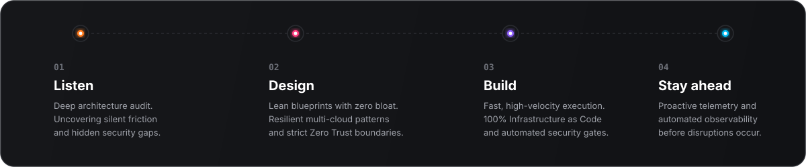

  

   

  

 

## What We Do

We partner with engineering leaders and executive teams to design, automate, and protect enterprise cloud foundations. No bloat, no generic templates — just deep engineering aligned with business velocity.

- **Cloud & Security**: Resilient, scalable multi-cloud architecture across AWS, GCP, and Azure with strict Zero Trust boundaries and Cisco perimeter defense.
- **DevSecOps & Automation**: 100% reproducible Infrastructure as Code (Terraform & OpenTofu), GitOps delivery, and automated security gates (JFrog Platform & Trivy).
- **AI & Platform Engineering**: Practical AI platforms, intelligent event telemetry, and automated observability designed for production scale.

 

---

## How We Work

Calm, structured, and fast. No unnecessary complexity. A four-stage path from discovery to live production.

  

 

---

## Who We Are

**OpsBit** is led by **Eliasaf Abargel**, Founder & Principal Cloud Architect, DevSecOps leader, and AI engineer.

We cut through cloud complexity, replace fragile setups with whole-system ownership, and build architectures where zero-trust security and rapid software delivery reinforce each other.

 

  <h3>Ready to solve your hardest engineering challenge?</h3>
  
Enterprise cloud architecture and security that listens before things break.

  

    <a href="mailto:eliasaf@opsbit.io"><strong>eliasaf@opsbit.io</strong></a> &nbsp;&bull;&nbsp;
    <a href="tel:+972509784550"><strong>+972 50-978-4550</strong></a> &nbsp;&bull;&nbsp;
    <a href="https://opsbit.io"><strong>opsbit.io</strong></a>
  

   

  

    

  <strong>OpsBit</strong> &middot; Principal Cloud Architecture &middot; Built with Intent

